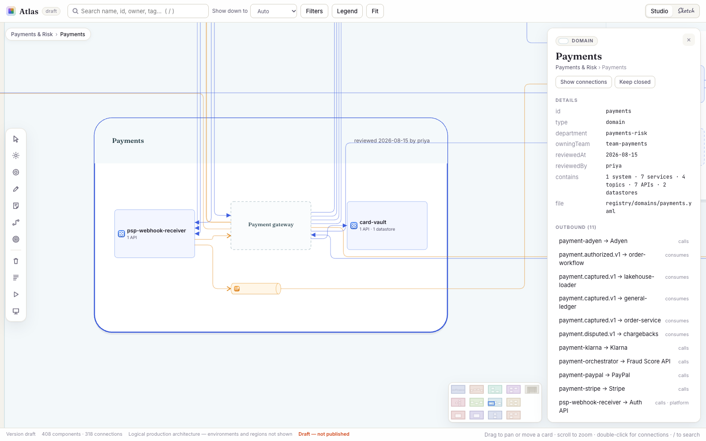
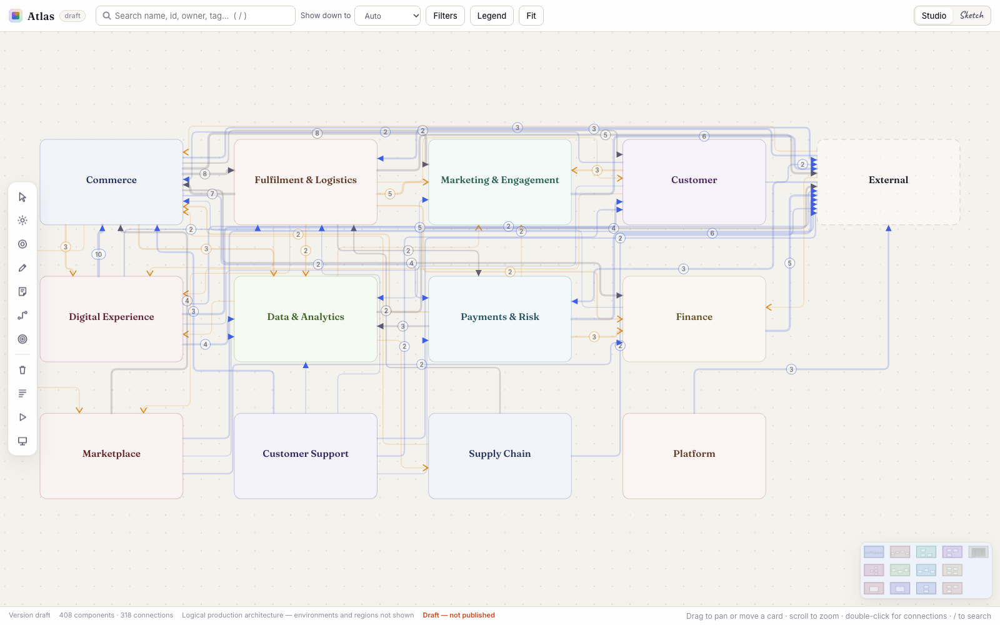

# Atlas

Atlas draws your system architecture as one zoomable board. You describe departments, domains, services, APIs, topics and datastores in YAML files kept in git. Atlas checks them, lays them out, and builds a single HTML file you can open anywhere, with no server needed. Zoomed out you see departments and domains. As you zoom in, services, APIs and topics appear inside them, and the connections regroup to match whatever is on screen.

Every card at a level is the same size, whatever it holds: all departments match, all domains in a department match, and so on. A card's contents are drawn smaller inside it and come into view as you zoom in, so the card you're heading for fills the screen as its neighbours slide out of frame, and zooming out brings back the same even grid. Cards never move when more detail appears, which is what lets people find their way around a large board the second time they open it. You can drag cards into an arrangement you prefer; that stays in your browser and "Reset layout" undoes it.



**[Try the demo](https://nakuls08.github.io/atlas/)**, a made-up e-commerce company with 12 departments, 38 domains, 114 services and 318 connections. There's also a [small example](https://nakuls08.github.io/atlas/small/) of about 40 entries and an [org graph](https://nakuls08.github.io/atlas/org-graph/) built from teams, APIs and access grants. Press `/` to search, double-click a card or a line to highlight its connections, and try `T` to trace a path between two cards.

To build the same board yourself:

```bash
npm install
npm run build:ecommerce      # writes dist/ecommerce/index.html
open dist/ecommerce/index.html
```

## Describing your architecture

The registry is a folder of YAML files, one per domain, plus a few shared files:

```
registry/
  departments.yaml
  clusters.yaml           # Kafka clusters
  externals.yaml          # partners and SaaS, and the connections they start
  tours.yaml              # guided walkthroughs (optional)
  domains/
    returns.yaml          # a domain's systems, services, APIs, topics, channels,
                          # datastores, and the connections it starts
```

A domain file looks like this:

```yaml
# registry/domains/returns.yaml
domain: { id: returns, name: Returns, department: logistics, owningTeam: team-returns,
          reviewedAt: 2026-09-18, reviewedBy: priya }
services:
  - { id: returns/returns-intake, name: returns-intake, owningTeam: team-returns }
apis:
  - { id: returns/returns-api, name: Returns API, hostedBy: returns/returns-intake,
      style: REST, audience: partner }
topics:
  - { id: returns/returns-created, name: returns.created.v1,
      ownedBy: returns/returns-intake, cluster: logistics-main }
connections:
  - { from: returns/returns-intake, to: returns/returns-created }   # publishes
  - { from: returns/returns-intake, to: billing/refund-api }        # calls
```

You don't name the kind of a connection. Atlas works it out from the two ends: a service pointing at an API calls it, a service pointing at a topic publishes to it, a topic pointing at a service is consumed by it. Any pair that doesn't make sense is rejected. A service may call another service directly only if you give a `gap` reason, which is how you record "we know there's an API here, it just isn't described yet".

There are optional fields for the messier parts of real systems: `role: platform` for shared infrastructure like auth, `tags` for hosts with many APIs (required above 8, and used to group them), `supersedes` for API versions, `ownership: disputed` with a `claimant`, and `status: planned` or `deprecated`. Each domain records when it was last reviewed, and the board marks domains that haven't been looked at in 180 days.

The smallest complete example is in [`examples/registry`](examples/registry), about 40 entries across 3 departments.

## Commands

| Command | What it does |
| --- | --- |
| `atlas validate -r <root>` | Checks every type, reference and connection rule, and names the file and entry for each problem |
| `atlas build -r <root> -o <dir>` | Builds the board as one HTML file, with fonts embedded so it works offline |
| `atlas build-spec0 -o <dir> --snapshot <file> --details <file>` | Builds a board from an org graph instead of a registry (see below) |
| `atlas build-spec0 -o <dir> --api <url>` | The same, loading the graph from a live server |

Run them with `npx tsx src/cli/main.ts <command>` or `bin/atlas.mjs <command>`.

## Using the board

Containers open by themselves once they're big enough on screen for their children's names to be readable, so you never get a screen of unlabelled boxes. "Show down to" in the toolbar overrides that, and a container's details panel has a button to keep it open or closed whatever the zoom.

Connections are routed at right angles around cards. Lines between the same two cards merge into one with a count, and lines that lead off screen are grouped by the domain they go to ("12 calls → Billing"). When a view would still draw more than 160 lines, both ends are grouped one level coarser and the board says so.

Moving around never changes the lines under you. Hovering does nothing to them, and while you pan or zoom they stay where they are, then regroup for the new view once you stop, with changed lines fading rather than blinking. Click a card to see its details and its inbound and outbound connections. Double-click a card to highlight its connections and dim everything else, or double-click a line to pick out just that connection and list what it stands for. Click empty space or press Esc to clear. Drag a closed card, or an open one by its title bar, to move it; dragging anywhere else pans. Press `/` to search. Filters cover connection kinds, platform links, Kafka clusters, tags and stale domains. The URL always reopens the exact view, so you can paste a link to "the Payments domain with these filters" into a ticket.

There are two drawing styles. Studio is the clean default. Sketch draws in handwriting on graph paper, which works better in a design review because nobody mistakes it for a finished diagram.



### Presenting and reviewing

| Key | Tool |
| --- | --- |
| `L` | Laser pointer |
| `S` | Spotlight (`[` and `]` resize it) |
| `P` | Pen and highlighter (`⌘Z` undo, `X` clear) |
| `N` | Review note on a card. Notes export as Markdown |
| `T` | Trace the path a request or event takes between two cards |
| `I` | Impact: what breaks if a card fails, or what it depends on |
| `⇧P` | Presenter mode |

Ink and notes stay in your browser's local storage. They never change the registry, so a reviewer can scribble on the board without it ending up in the published version.

Guided tours live in `registry/tours.yaml`. Each step has a caption and either focuses a card, traces a path or shows an impact. You can record a draft tour in the viewer and copy it out as YAML, so tours go through the same review as the rest of the registry.

## Org graphs from Spec0

Atlas can also draw an organisation that isn't described in YAML. Here the input is a graph of teams, services, APIs and the access grants between them, as [Spec0](https://spec0.io) serves it for its org graph. The page loads one snapshot on open and fetches each API's operations in batches as you zoom into it. The hierarchy (by team or by domain) is chosen in the viewer and built in the browser, so switching costs nothing. [docs/graph-api.md](docs/graph-api.md) describes the format.

```bash
npm run spec0:fixture && npm run build:spec0   # dist/spec0/index.html, from a generated fixture
```

## Development

Requires Node 22.12 or later.

```bash
npm test                     # vitest
npm run type-check           # tsc --noEmit
npm run validate:example     # check the small example registry
npm run build:demo           # build all three demo boards into dist/demo
```

The scripts in `scripts/` that take screenshots or measure frame rate drive your locally installed Chrome through `playwright-core`; set `CHROME` if it isn't in the default macOS location. See [CONTRIBUTING.md](CONTRIBUTING.md) for how the code is laid out and the rules that keep cards still.

## Status

This is a working prototype. Validation, the read-only board and the review tools work end to end. Editing the registry from the board, reviewing a change as a diff on the board, publishing through pull requests and saving layout positions between builds aren't built yet. They're tracked in the [issues](https://github.com/nakuls08/atlas/issues), along with a dense full zoom-out on large boards (visible in the screenshot above).

## Licence

MIT. See [LICENSE](LICENSE).
